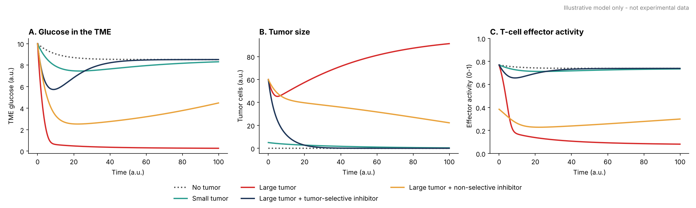
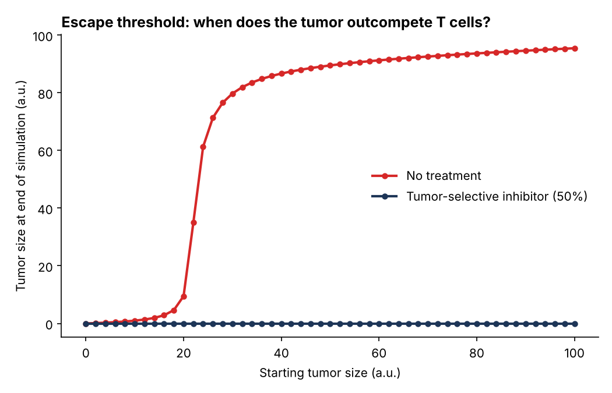
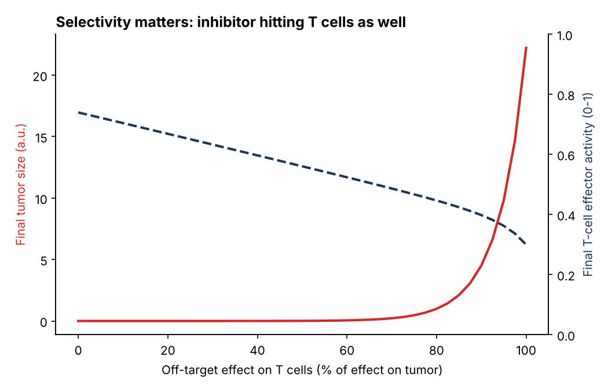
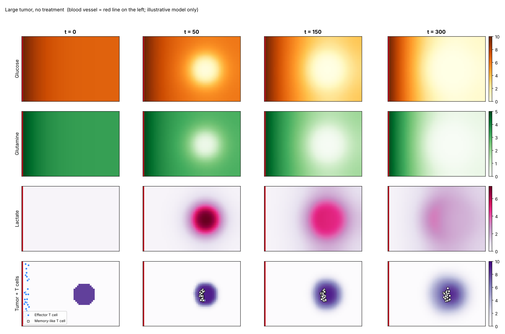
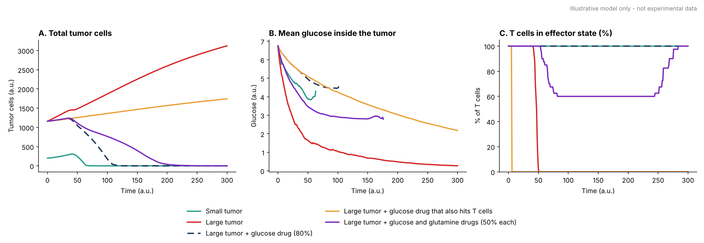

# Starved in the Tumor: Simplified Models of Nutrient Competition Between Tumor Cells and T Cells

> **Disclaimer.** This repository contains **simplified, illustrative models**. All parameter values are chosen to show qualitative behaviour; they are not measured or fitted to experimental data. The outputs are **not experimental results and not new scientific findings**. The purpose of the project is to make concepts from my published review literature concrete and explorable in code.

**Author:** Alper Öztürk

**Try it in the browser:** `web/index.html` (spatial model) and `web/simple.html` (simple model). See [Section 6](#6-interactive-versions).

The repository contains two models of increasing realism:

| | Version 1: `tme_glucose.py` | Version 2: `tme_spatial.py` |
|---|---|---|
| Nutrients | Glucose | Glucose and glutamine |
| Lactate | No | Yes, made by tumor cells; suppresses T cells |
| Tissue | One well-mixed compartment | 60 × 40 grid fed by a blood vessel; nutrients diffuse |
| T cells | One number for "activity" | 40 individual cells that move, kill and switch state |
| T-cell states | Active ↔ inactive (continuous) | Effector (glycolytic) ↔ memory-like (oxidative) |
| Method | Euler method, 3 equations | Euler method on a grid + agent-based T cells |

---

## 1. Connection to my research

| Paper | What the paper says | How this repository uses it |
|---|---|---|
| **#93: "Immunometabolism: How Metabolic Reprogramming Controls Immune Cell Activation and Function"** <!-- add link --> | Effector T cells rely on aerobic glycolysis and glutaminolysis to proliferate and produce cytokines, while memory and regulatory T cells rely on fatty acid oxidation (FAO) and OXPHOS, with AMPK favouring the oxidative state (Sections 2.3, 6.1, Table 1). In the tumor microenvironment (TME), tumor cells compete for glucose and amino acids, build up lactate and create hypoxia, which together suppress effector T-cell glycolysis; targeting glycolytic enzymes or amino-acid transporters can enhance antitumor responses in preclinical models (Section 6.4, summarizing Hu et al., 2024). | T-cell function depends on the glucose and glutamine they can get, and is reduced by lactate. T cells that run out of fuel switch from a glycolytic effector state to a quiet, oxidative memory-like state. Drugs block tumor glucose and/or glutamine uptake. |
| **#94: "Metabolic Reprogramming in Cancer Cells"** <!-- add link --> | Cancer cells reprogram their metabolism, including the Warburg effect (high glucose uptake and lactate production even with oxygen) and glutaminolysis. | Tumor cells take up glucose and glutamine with higher affinity than T cells and convert much of the glucose into lactate. |

**What comes from my papers and what does not.** The qualitative ideas above come from the literature I reviewed. Everything else is **my own modelling choice** and is not reported in my papers: the equations, all parameter values, the escape threshold, the inhibitor experiments, the spatial layout, and in particular the rule that a starved effector T cell *switches to a memory-like state* (my paper describes effector and memory cells using different metabolic programs; it does not say that starvation converts one into the other).

---

## 2. Version 1: the simple model (`tme_glucose.py`)

The model tracks three quantities over time (arbitrary units, a.u.): **G** (glucose in the TME), **N** (tumor cells) and **E** (T-cell effector activity, 0 to 1). The number of T cells **T** is constant. Glucose use saturates as $f(G) = G/(K_m + G)$; tumor cells have the lower $K_m$, so they keep feeding when glucose is scarce.

$$\frac{dG}{dt} = s - w\,G - V_{\text{tumor}}\, f_{\text{tumor}}(G)\, N - V_{\text{T}}\, f_{\text{T}}(G)\, T$$

$$\frac{dN}{dt} = r\, f_{\text{tumor}}(G)\, N\left(1 - \frac{N}{K}\right) - k\, E\, T\, N, \qquad E = f_{\text{T}}(G)$$

Drugs multiply $f_{\text{tumor}}$ and/or $f_{\text{T}}$ by $(1 - \text{inhibition})$. Equations are solved with the **Euler method**: *new value = old value + rate of change × dt*.

| Parameter | Value | Meaning |
|---|---|---|
| `supply` / `washout` | 1.0 / 0.1 | glucose entering / fraction leaving per time unit |
| `tumor_vmax` / `tumor_km` | 0.05 / 1.0 | tumor glucose uptake: maximum / half-saturation |
| `tcell_vmax` / `tcell_km` | 0.02 / 3.0 | T-cell glucose uptake: maximum / half-saturation |
| `tumor_growth` / `tumor_capacity` | 0.3 / 200 | tumor growth rate / maximal size |
| `n_tcells` / `kill_rate` | 10 / 0.04 | number of T cells / killing strength |

### Results (model behaviour)



- **No tumor / small tumor:** glucose stays high, T cells stay active (E ≈ 0.74), and a small tumor is cleared.
- **Large tumor:** the tumor drains glucose (G falls below 0.3), T-cell activity collapses (E ≈ 0.08) and the tumor grows.
- **Large tumor + tumor-selective inhibitor (50%):** glucose recovers, T cells recover and the tumor is cleared.
- **Large tumor + non-selective inhibitor (50% on both cell types):** the benefit is much smaller by t = 100.



**Escape threshold.** Below a starting size of about 20 a.u. the T cells control the tumor; above it, the tumor escapes. This comes from a positive feedback loop in the model: larger tumor → less glucose → weaker T cells → less killing → larger tumor.



**Selectivity.** When the inhibitor also blocks T-cell glycolysis, its benefit shrinks; above roughly 70–80% off-target effect the tumor is no longer cleared within the simulated time. This illustrates a trade-off in the model, not a finding about any real drug.

---

## 3. Version 2: the spatial model (`tme_spatial.py`)

### What is modelled

The tissue is a **60 × 40 grid**. A blood vessel runs along the left edge.

- **Fields on the grid:** glucose $G$, glutamine $Q$, lactate $L$ and tumor cells $N$ (0 to 10 per square).
- **Diffusion:** each field spreads to neighbouring squares, $D \nabla^2 c$, computed from the difference between a square and its 4 neighbours. The vessel column is held at blood levels of glucose (10) and glutamine (5) and washes lactate away. Normal tissue uses a little of each nutrient, so squares far from the vessel get less food.
- **Tumor cells** in each square take up glucose and glutamine (saturating curves, high affinity), turn glucose into lactate (1.5 units of lactate per unit of glucose, a stand-in for the Warburg effect), and grow in proportion to *both* nutrient supplies:

$$\frac{\partial N}{\partial t} = D_N \nabla^2 N + r\, f_G\, f_Q\, N\left(1 - \frac{N}{K}\right) - \text{killing}$$

- **T cells** are 40 individual agents. Each has a **fitness** at its location:

$$\text{fitness} = \frac{f^{T}_G(G)\; f^{T}_Q(Q)}{1 + L / K_L}$$

  i.e. it needs glucose *and* glutamine, and lactate halves its function when $L = K_L = 3$.
- **Effector ↔ memory-like switch:** an effector T cell whose fitness stays below 0.15 for 5 time units switches to a **memory-like** state: it moves slowly, uses 20% of the fuel and does not kill (a simplified oxidative, OXPHOS/FAO-like state). If its fitness stays above 0.35 for 5 time units, it switches back. The gap between the two thresholds prevents cells from flickering.
- **Movement:** effectors move up the tumor-density gradient (a simple stand-in for chemokine signals) plus a random component; memory-like cells wander slowly.
- **Killing:** each effector kills tumor cells in its square at a rate proportional to its fitness.
- **Drugs:** block tumor glucose uptake, tumor glutamine uptake, and (optionally) T-cell glucose uptake as a side effect.

Before each run, glucose and glutamine are allowed to settle into their healthy-tissue gradient. Time runs to t = 300 with dt = 0.1. All parameters are listed and commented in `DEFAULT_PARAMS` in `tme_spatial.py`.

### Results (model behaviour)



**Large tumor, no treatment.** Within 50 time units the tumor creates a hole in the glucose and glutamine maps and a cloud of lactate. T cells that reach the tumor lose their fuel and switch to the memory-like state (grey) at around t ≈ 40–50. With no effector cells left, the tumor keeps growing outward and drains nutrients from most of the tissue. Lactate later decreases because the starved tumor core takes up less glucose.



| Scenario | Tumor at t = 300 | Effector T cells at t = 300 |
|---|---|---|
| Small tumor | cleared | 40 / 40 |
| Large tumor | ≈ 3,100 (grew from ≈ 1,160) | 0 / 40 |
| Large tumor + glucose drug (80%) | cleared | 40 / 40 |
| Large tumor + the same drug also hitting T cells (80%) | ≈ 1,740 | 0 / 40 |
| Large tumor + glucose and glutamine drugs (50% each) | cleared | 40 / 40 |

Observations from the model:

1. **Escape size.** Tumors of radius 3 are cleared; from radius 4 the tumor escapes (radius 4 still has about half of the T cells active at t = 60, but they switch off soon after).
2. **Combination beats a single drug.** A glucose-uptake block alone needs about 80% to work (50–60% fails), but 50% glucose + 50% glutamine block together clears the tumor, because blocking only glucose leaves the tumor draining glutamine, which T cells also need.
3. **The switch is reversible.** In the combination scenario, about 40% of T cells switch to the memory-like state while the tumor is still large, then switch back to effectors as the tumor shrinks and nutrients return (panel C).
4. **Selectivity still matters.** The same 80% glucose drug that cures in the selective scenario fails when it also blocks T-cell glucose uptake.
5. **Timing.** In additional runs, starting the drugs late (t ≥ 50), after all T cells have switched off inside the tumor, did not rescue them, because the memory-like cells sit in the tumor core where glucose, glutamine and lactate stay unfavourable.

T-cell movement is random, so exact numbers change slightly between runs (`seed` parameter); the patterns above are stable.

---

## 4. Limitations

Both models deliberately leave out a great deal of biology:

- **No hypoxia, HIF-1α or mTOR/AMPK signalling.** The effector ↔ memory-like switch is a fitness threshold, not a model of the actual signalling network described in paper #93.
- **The starvation-induced switch is my assumption.** Real T cells under chronic nutrient stress can also become exhausted or die; the memory-like state here is a simplification.
- **Fixed T-cell number.** No proliferation, death or new T cells arriving from the blood.
- **Simplified space.** One straight vessel, a coarse 2D grid, and "move toward tumor" instead of real chemokine gradients.
- **Arbitrary units and parameters.** Thresholds, doses and times have no real-world meaning; only the qualitative patterns are of interest.
- **Simple numerical method.** The Euler method is easy to follow but less accurate than adaptive solvers.

---

## 5. Files

```
tme_glucose.py      version 1: simple model, figures 1-3
tme_spatial.py      version 2: spatial model, figures 4-5
figures/            all figures produced by the scripts
web/index.html      interactive spatial model (version 2)
web/simple.html     interactive simple model (version 1)
requirements.txt    numpy, matplotlib
```

## 6. Interactive versions

The `web/` folder contains PhET-style browser versions of both models; they need no installation. They show an animated tissue next to live graphs, with sliders for tumor size, drug doses and T-cell number. The spatial page can display glucose, glutamine or lactate maps, lets you move the tumor closer to the vessel, and lets you switch the lactate effect off. Both pages use the same equations and default parameters as the Python scripts and run to t = 300.

### Accessibility: color-blind-friendly colors

All figures and both interactive pages were checked for readers with color vision deficiency. I simulated protanopia, deuteranopia and tritanopia (Machado et al., 2009 simulation matrices) and measured the color difference (CIELAB ΔE) between every pair of colors that must be told apart, such as tumor cells vs T cells, effector vs memory-like T cells, and the lines in each graph. Pairs that were too similar were fixed:

- **Shape as well as color.** Effector T cells are drawn as circles and memory-like T cells as squares, in both the figures and the interactive page.
- **Line style as well as color.** In Figure 1 the "No tumor" line is dotted; in Figure 5 the "glucose drug (80%)" line is dashed so that it stays visible where it overlaps other lines.
- **Lightness contrast.** Tumor cells (dark purple) and effector T cells (light blue) differ strongly in lightness, which remains visible under all three simulated conditions, in light and dark mode.
- **Single-hue maps.** The glucose, glutamine and lactate maps each go from light to dark in one hue, so they are read by lightness rather than by hue.

To publish them with GitHub Pages: *Settings → Pages → Deploy from branch*, then open `https://<your-username>.github.io/<repo-name>/web/`.

## 7. How to run the Python models

Requires Python 3 with `numpy` and `matplotlib`.

```bash
pip install -r requirements.txt
python tme_glucose.py     # version 1, about 1 second
python tme_spatial.py     # version 2, about 10 seconds
```

Each script prints a summary for every scenario and saves its figures in `figures/`. To try your own scenario, change `DEFAULT_PARAMS` or add an entry to `SCENARIOS`.

---

## 8. Reference cited above

The reference below is cited in my paper #93 and is the source summarized there for the TME and therapeutic statements:

- Hu, T., Liu, C.-H., Lei, M., Zeng, Q., Li, L., Tang, H., & Zhang, N. (2024). Metabolic regulation of the immune system in health and diseases: Mechanisms and interventions. *Signal Transduction and Targeted Therapy*, 9, 268. https://doi.org/10.1038/s41392-024-01954-6
